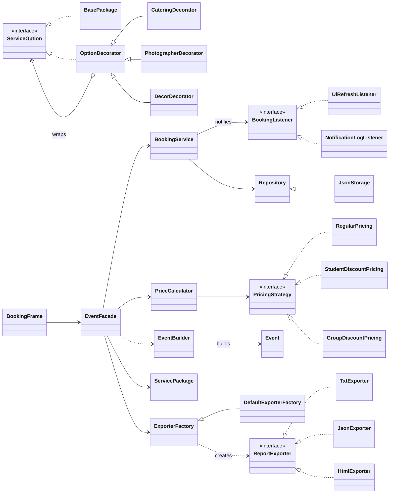
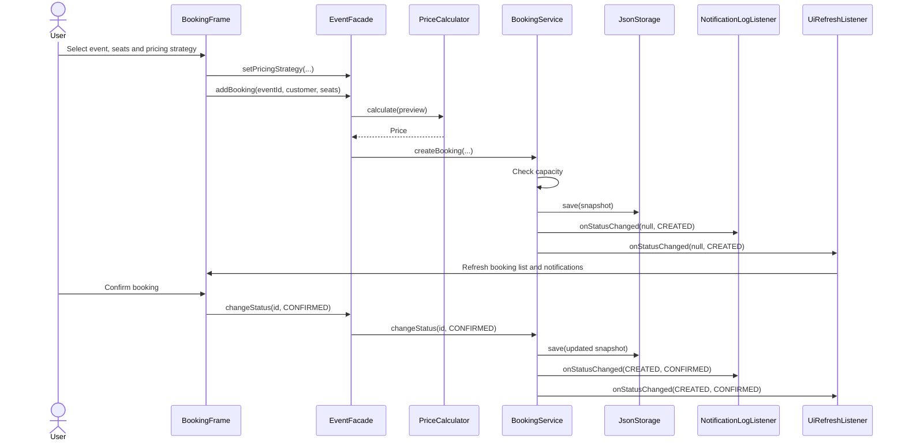

# Event Studio

Event Studio is a Java 25 desktop application for creating events, configuring optional service packages, booking seats, changing booking status, viewing event summaries, and exporting a summary as TXT, JSON, or HTML. It uses six design patterns in one Swing application.

## Requirements and launch

- JDK 25 and Maven 3.9 or newer. Check `java -version` and `mvn -version`.
- Run tests: `mvn clean test`.
- Run the GUI: `mvn compile exec:java`.
- In IntelliJ IDEA, open the directory containing `pom.xml`, select JDK 25, and run `org.example.Main`.

The ordinary JAR created by `mvn package` does not bundle dependencies; use the Maven command or an IDE. On the first launch, `Main` creates two demonstration events. The application stores events and bookings in `data/bookings.json` and loads them at startup.

For a demonstration with existing bookings, close the application, create a **separate demo copy** of the project, and copy [`sample-data/bookings.json`](sample-data/bookings.json) to `data/bookings.json` in that copy. Do not overwrite existing data. The sample concert has eight seats, five reserved seats, and one cancelled booking. Its total under regular/student/group pricing is 5,000.00 / 4,500.00 / 4,250.00 KZT.

## Main user journey

1. In **Events**, create or select an event. Enter its date (`YYYY-MM-DD`), location, capacity, and ticket price. You can edit an event or delete one with no bookings.
2. In **Service package**, set a base cost and select catering, photographer, or decor. The package description and cost update immediately. Save it for the selected event.
3. In **Bookings**, choose an event, customer, seat count, and pricing strategy. Review the price, create a booking, and confirm or cancel it. The booking list and notification panel update when its status changes.
4. In **Summary and export**, review customers, booking lines, occupied/available seats, and the total for the selected event. Choose TXT, JSON, or HTML and export the visible summary.

Created and confirmed bookings reserve seats; cancelled bookings release them and contribute zero to the summary total. Group pricing requires at least five seats **in each active booking**. If it cannot price a booking, the summary shows an error and export is unavailable until a suitable strategy is selected. The chosen pricing strategy affects the current view and summary; it is not stored in a booking.

## Architecture and patterns

The Swing UI calls `EventFacade`, which coordinates `BookingService`, `PriceCalculator`, `EventBuilder`, `ServicePackage`, `Summary`, and `ExporterFactory`. `BookingService` owns capacity and status rules, persists events and bookings through `Repository`/`JsonStorage`, and notifies `BookingListener` subscribers after a successful change.

| Pattern | Problem it solves | Main participants | Demonstration | Responsible member |
| --- | --- | --- | --- | --- |
| Builder (creational) | Build a valid event from several form fields | `EventBuilder`, `Event` | Create an event; show combined validation errors | Abilkhaiyr Akmaral (A) |
| Factory Method (creational) | Select an exporter without changing the export operation | `ExporterFactory`, `DefaultExporterFactory`, `ReportExporter`, TXT/JSON/HTML exporters | Export the same summary in three formats | Konys Ramazan (C) |
| Decorator (structural) | Combine optional package services and costs | `ServiceOption`, `BasePackage`, `OptionDecorator`, three concrete decorators | Toggle extras and compare cost/description | Abilkhaiyr Akmaral (A) |
| Facade (structural) | Give the GUI one entry point to coordinated operations | `EventFacade` and delegated services | Create a booking, view summary, and export | Konys Ramazan (C) |
| Strategy (behavioral) | Change ticket-pricing rules at runtime | `PricingStrategy`, `PriceCalculator`, regular/student/group strategies | Switch strategies for the same booking | Ruslankyzy Aldina (B) |
| Observer (behavioral) | React to booking status changes | `BookingService`, `BookingListener`, `UiRefreshListener`, `NotificationLogListener` | Create/confirm/cancel and observe UI/log updates | Ruslankyzy Aldina (B) |

### Class diagram

### Sequence diagram: create and confirm a booking

## Test scenarios and recorded results

| # | Input / action | Expected result | Recorded result |
| --- | --- | --- | --- |
| 1 | Create an event, configure extras, book and confirm, edit and reload | Event/booking restored; totals and capacity correct | Passed in `EventCatalogScenarioTest` |
| 2 | Price one five-seat booking using regular, student, and group rules | 5,000 / 4,500 / 4,250 KZT | Passed in `PriceCalculatorTest` |
| 3 | Change the pricing choice in the UI | Preview reflects the selected strategy | Passed in `PricingOptionTest` |
| 4 | Create, confirm, cancel, then restart | Listeners receive all transitions; JSON restores state | Passed in booking and storage tests |
| 5 | Submit a blank event name | Validation error; no event saved | Passed in `EventCatalogScenarioTest` |
| 6 | Submit zero/negative capacity or price | Validation error; no state change | Passed in `EventCatalogScenarioTest` |
| 7 | Export a student-priced summary in TXT, JSON, HTML | Three readable files; total 4,500 KZT; 5 of 8 seats reserved | Passed in `EventFacadeTest` |
| 8 | Book beyond capacity and then cancel a booking | Excess booking rejected; cancellation releases seats | Passed in `EventFacadeTest` |

The full integrated branch was verified on 12 November 2026 with JDK 25 and Maven 3.9.11: **59 tests, 0 failures, 0 errors, 0 skipped; BUILD SUCCESS** (`mvn clean test`). This includes the booking, pricing, Builder, Decorator, Factory Method, Facade, export, validation, and Swing UI test classes. Run the same command locally to reproduce the result.

## Detailed English reports

- [Illustrated project report (DOCX)](docs/Event-Studio-Project-Report.docx)
- [Strategy, Observer, booking and JSON storage](docs/report-booking.md)
- [Factory Method, Facade, summary and export](docs/report-gui-facade.md)
- [Builder, Decorator, validation and event management](docs/report-model-builder.md)

## Current limitations and submission materials

- Events and bookings survive a restart; configured service packages currently live only in `EventFacade` memory and must be configured again after restart.
- The summary treats customer names as strings, so two people with the same name are not distinct participant identities.
- The illustrated DOCX report includes diagrams and interface screenshots. The course requires a PDF report, which still needs to be exported and submitted. The README diagrams provide class and sequence views in Mermaid.
- The GUI's file chooser and overwrite confirmation require a manual check in a graphical environment.

Java/Swing, Jackson, JUnit, and Maven are used in the implementation.
