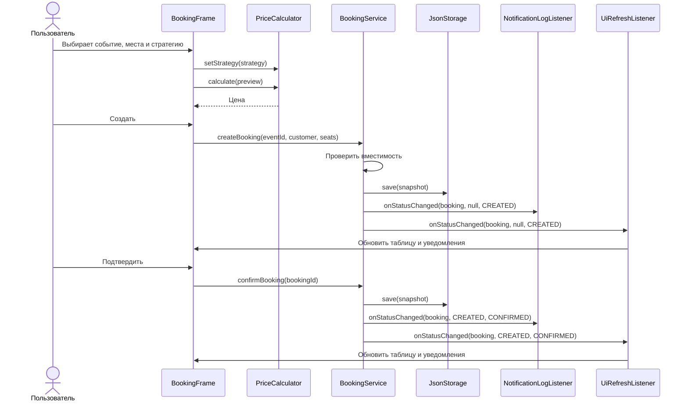

# Бронирование: Strategy и Observer

## Запуск

Запустить `org.example.Main` на Java 25. При первом запуске создаются два события.
События и брони сохраняются в `data/bookings.json`; при следующем запуске они
загружаются из этого файла. Для проверки выполнить `mvn test`.

Обычная цена равна цене места, умноженной на число мест. Студенческая скидка
составляет 10%, групповая — 15% для брони от пяти мест. Созданная и
подтверждённая бронь занимает места; отменённая освобождает их.

## Sequence diagram: создание и подтверждение брони



## Таблица паттернов

| Паттерн | Участники | Где применяется | Результат |
|---|---|---|---|
| Strategy | `PricingStrategy`, `RegularPricing`, `StudentDiscountPricing`, `GroupDiscountPricing`, `PriceCalculator` | Выбор стратегии в `BookingFrame` вызывает `setStrategy()` | Цена одной брони пересчитывается без изменения модели брони. |
| Observer | `BookingListener`, `BookingService`, `UiRefreshListener`, `NotificationLogListener` | Создание, подтверждение и отмена вызывают `notifyListeners()` | Таблица и журнал уведомлений обновляются после смены статуса. |

## Тесты

| № | Сценарий | Шаги | Ожидаемый результат | Автотест |
|---|---|---|---|---|
| 1 | Одна бронь, три цены | Рассчитать бронь на 5 мест по 100 через три стратегии. | 500.00, 450.00 и 425.00. | `PriceCalculatorTest.sameBookingHasThreePricesWhenStrategyChanges` |
| 2 | Переключение стратегии | Выбрать последовательно обычную, студенческую и групповую стратегию. | `PriceCalculator` применяет выбранную стратегию; цена меняется. | `PricingOptionTest.selectingEachOptionSwitchesThePrice` |
| 3 | Реакция на событие | Создать, подтвердить и отменить бронь. | Подписчики получают переходы `null → CREATED`, `CREATED → CONFIRMED`, `CONFIRMED → CANCELLED`; интерфейс обновляется. | `BookingServiceTest.creationConfirmationAndCancellationNotifySubscribers` |
| 4 | Сохранение и загрузка | Создать и подтвердить бронь, создать новый экземпляр сервиса с тем же JSON-файлом, затем отменить и повторить загрузку. | Событие, бронь и статус восстанавливаются; после отмены места доступны. | `JsonStorageTest.restartRestoresEventsBookingsAndStatus` |
| 5 | Проверка вместимости | Занять 4 из 6 мест, запросить ещё 3, отменить первую бронь. | Лишняя бронь отклоняется; отмена освобождает 4 места. | `BookingServiceTest.capacityIsReservedOnCreationAndReleasedOnCancellation` |

## Фрагменты кода

### Strategy

```java
public interface PricingStrategy {
    BigDecimal calculate(Booking booking);
}

PriceCalculator calculator = new PriceCalculator(new RegularPricing());
calculator.setStrategy(new StudentDiscountPricing());
BigDecimal price = calculator.calculate(booking);
```

### Observer

```java
public interface BookingListener {
    void onStatusChanged(Booking booking, BookingStatus oldStatus, BookingStatus newStatus);
}

service.subscribe(new NotificationLogListener());
service.subscribe(new UiRefreshListener(this::refreshView));
service.confirmBooking(booking.id()); // Оба подписчика получают CREATED -> CONFIRMED.
```
