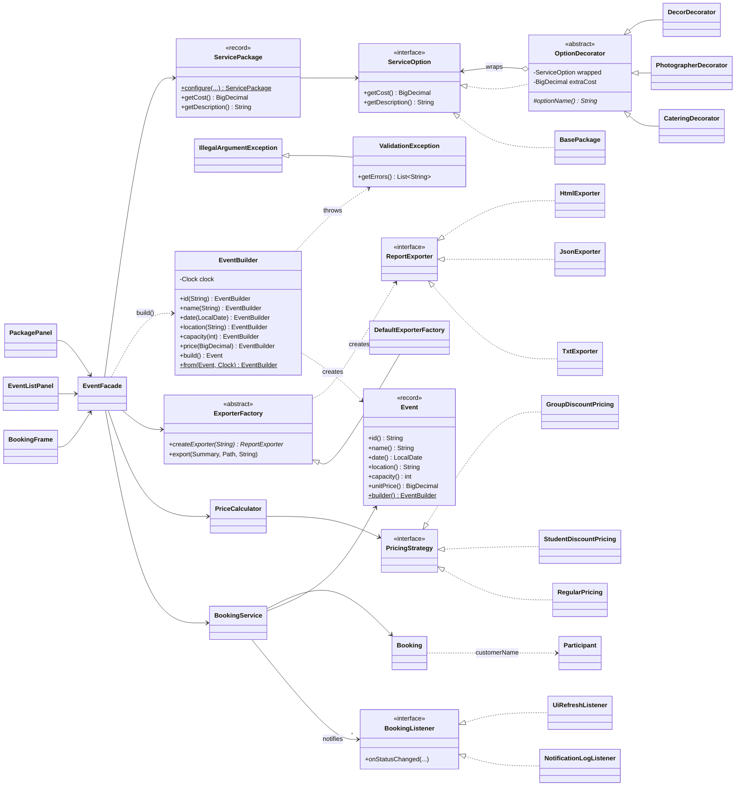

# Участник А: модели, Builder, Decorator и валидация

## Архитектура

Event Studio — настольное Java/Swing-приложение с одной точкой входа `org.example.Main`.
Слои и зависимости направлены сверху вниз:

| Слой | Пакет | Содержимое |
| --- | --- | --- |
| Интерфейс | `ui` | `BookingFrame` и вкладки: «Бронирования», «Итог и экспорт», «Мероприятия» (`EventListPanel`), «Пакет услуг» (`PackagePanel`); общий `ErrorDialog` |
| Фасад | `facade` | `EventFacade` — единая точка доступа GUI к сервисам, Builder, Decorator и экспорту |
| Модель и правила | `booking`, `servicepackage`, `validation`, `pricing`, `model` | `Event`/`EventBuilder`, `Participant`, `Booking`, `ServicePackage` и декораторы, `ValidationException`, стратегии цены, `Summary` |
| Хранилище | `storage` | `Repository`, `JsonStorage` (`data/bookings.json`), `InMemoryRepository` |
| Экспорт | `export` | `ExporterFactory` и экспортёры TXT/JSON/HTML |

Поток создания мероприятия: поля формы `EventListPanel` → `InputParser` (текст → число/дата)
→ шаги `EventBuilder` → `EventFacade.createEvent(builder)` → `build()` проверяет все правила
→ `BookingService.addEvent` сохраняет через `Repository`. Любое нарушение — это
`ValidationException`; она наследует `IllegalArgumentException`, поэтому существующий
обработчик окна показывает её текст в диалоге «Ошибка» без отдельной обработки.

Поток настройки пакета: мероприятие, базовая стоимость и флажки допов на вкладке
«Пакет услуг» → `EventFacade.configurePackage` → `ServicePackage.configure` оборачивает
`BasePackage` в выбранные декораторы → цена и состав показываются сразу (предпросмотр)
и запоминаются для мероприятия после «Сохранить пакет».

### Class diagram всех паттернов



## Паттерны (строки участника А)

| Паттерн | Тип | Реализация | Назначение |
| --- | --- | --- | --- |
| Builder | Порождающий | `Event`, `EventBuilder` (`name()`, `date()`, `location()`, `capacity()`, `price()`, `build()`) | Пошаговое создание мероприятия из полей формы; `build()` проверяет все поля разом и возвращает неизменяемый `Event` |
| Decorator | Структурный | `ServiceOption`, `BasePackage`, `OptionDecorator`, `CateringDecorator`, `PhotographerDecorator`, `DecorDecorator` | Добавление платных услуг к пакету в любой комбинации без подклассов на каждое сочетание |

`price()` и необязательный `id()` добавлены к перечню методов Builder: без цены билета
мероприятие нельзя бронировать, а стабильный id нужен при редактировании.

### Фрагмент Builder

```java
public Event build() {
    List<String> errors = new ArrayList<>();
    String cleanName = trim(name);
    if (cleanName.isEmpty()) {
        errors.add("Название мероприятия не может быть пустым");
    }
    if (date == null) {
        errors.add("Укажите дату мероприятия");
    } else if (date.isBefore(LocalDate.now(clock))) {
        errors.add("Дата мероприятия не может быть в прошлом");
    }
    // ... место, вместимость (1..10000), цена > 0
    if (!errors.isEmpty()) {
        throw new ValidationException(errors);
    }
    return new Event(eventId, cleanName, capacity, price, date, cleanLocation);
}
```

Использование из интерфейса (`EventListPanel`):

```java
facade.createEvent(new EventBuilder()
        .name(nameField.getText())
        .date(InputParser.parseDate(dateField.getText(), "Дата"))
        .location(locationField.getText())
        .capacity(InputParser.parseInt(capacityField.getText(), "Вместимость"))
        .price(InputParser.parseMoney(priceField.getText(), "Цена билета")));
```

### Фрагмент Decorator

```java
public abstract class OptionDecorator implements ServiceOption {
    private final ServiceOption wrapped;
    private final BigDecimal extraCost;

    @Override
    public BigDecimal getCost() {
        return wrapped.getCost().add(extraCost);
    }

    @Override
    public String getDescription() {
        return wrapped.getDescription() + " + " + optionName();
    }
}

ServiceOption option = new BasePackage(baseCost);
if (catering)     option = new CateringDecorator(option);      // +50 000 KZT
if (photographer) option = new PhotographerDecorator(option);  // +30 000 KZT
if (decor)        option = new DecorDecorator(option);         // +20 000 KZT
```

## Модели

| Класс | Поля | Примечание |
| --- | --- | --- |
| `Event` | id, name, capacity, unitPrice, date, location | Record; добавлены date и location. 4-аргументный конструктор сохранён для существующего кода и старых JSON-файлов (date = null) |
| `Participant` | name, email | Record с проверкой имени и формата email; используется фасадом при создании брони |
| `Booking` | id, eventId, customerName, seatCount, unitPrice, status | Модель участника Б, не изменена |
| `ServicePackage` | eventId, option (цепочка декораторов), флаги допов | `getCost()`, `getDescription()`, `getBaseCost()` |

## Валидация

| Проверка | Где | Сообщение |
| --- | --- | --- |
| Пустое название / место | `EventBuilder.build` | «Название мероприятия не может быть пустым», «Место проведения не может быть пустым» |
| Название длиннее 100 символов | `EventBuilder.build` | «…не может быть длиннее 100 символов» |
| Дата в прошлом / не указана | `EventBuilder.build` | «Дата мероприятия не может быть в прошлом», «Укажите дату мероприятия» |
| Вместимость ≤ 0 или > 10 000 | `EventBuilder.build` | «Вместимость должна быть больше нуля» / «…не может превышать 10000» |
| Цена билета ≤ 0 | `EventBuilder.build` | «Цена билета должна быть больше нуля» |
| Пустое поле, не число, неверная дата | `InputParser` | «Вместимость: введите целое число», «Дата: используйте формат ГГГГ-ММ-ДД» |
| Стоимость базового пакета ≤ 0, отрицательная стоимость допа | `BasePackage`, `OptionDecorator` | «Стоимость базового пакета должна быть больше нуля» |
| Пустое имя участника, неверный email, мест ≤ 0 | `Participant`, `EventFacade.addBooking` | «Имя участника не может быть пустым» |
| Вместимость меньше уже забронированных мест | `EventFacade.updateEvent` | «Вместимость не может быть меньше уже забронированных мест (N)» |
| Удаление мероприятия с бронями (в т. ч. отменёнными) | `EventFacade.deleteEvent` | «Нельзя удалить мероприятие, у которого есть брони» |

`EventBuilder` собирает все нарушения сразу; `ValidationException.getErrors()` хранит
их списком, а сообщение исключения выводит каждое с новой строки. `BookingService`
дублирует правила вместимости и удаления (`IllegalStateException`) как защиту данных.

## Пользовательские сценарии и тесты

| № | Входные данные / действия | Ожидаемый результат | Автоматическая проверка |
| --- | --- | --- | --- |
| 1 | Создать «Конференция IT» (дата +20 дней, Астана, 10 мест, 2000 KZT); пакет 100 000 + кейтеринг + фотограф; бронь «Әсел» на 3 места, подтвердить; изменить место и вместимость на 12; перезапуск; создать и удалить второе мероприятие | Пакет 180 000.00; итог 6000.00; свободно 9; изменения восстановлены после перезапуска; удалённое мероприятие и его пакет исчезли | `EventCatalogScenarioTest.scenario1CreateConfigureBookEditAndDeleteSuccessfully` |
| 5 | Название из пробелов | ValidationException «Название мероприятия не может быть пустым»; список пуст, файл не создан | `EventCatalogScenarioTest.scenario5EmptyEventNameIsRejectedWithMessageAndNothingIsSaved` |
| 6 | Вместимость 0 и −5; цена 0 и −100; базовый пакет −1; редактирование вместимости на 0 | Сообщения «Вместимость должна быть больше нуля» / «Цена билета должна быть больше нуля»; данные не меняются | `EventCatalogScenarioTest.scenario6ZeroOrNegativeCapacityOrPriceIsRejected` |

Автотесты паттернов: `EventBuilderTest` (Builder: все поля, генерация id, `from`, сбор
всех ошибок, границы) и `ServiceOptionDecoratorTest` (Decorator: базовый пакет,
цена с тремя допами 200 000.00, независимость от порядка, отрицательные цены).
Дополнительно: `ParticipantTest`, `InputParserTest`, `BookingServiceEventCrudTest`
(редактирование, удаление, откат при ошибке записи), `EventScreensTest` (формы
вкладок «Мероприятия» и «Пакет услуг» на Swing EDT) и проверка загрузки мероприятий,
сохранённых без даты и места.

Ручная проверка: вкладка «Мероприятия» — оставить название пустым и нажать
«Создать мероприятие» (сценарий 5); ввести вместимость 0 или цену −1 (сценарий 6).
Вкладка «Пакет услуг» — отметить допы и убедиться, что «Итого» пересчитывается сразу.

## Ограничения

- Сохранённые пакеты услуг хранятся в памяти фасада и не попадают в `bookings.json`:
  формат хранилища Б (`BookingSnapshot`) не расширялся.
- Мероприятия, созданные до этой ветки, не имеют даты и места; в списке показывается «—».
  При редактировании такого мероприятия нужно указать дату и место.
- Дата хранится в JSON как строка `ГГГГ-ММ-ДД` (собственный десериализатор), поэтому
  новая зависимость `jackson-datatype-jsr310` не нужна.
